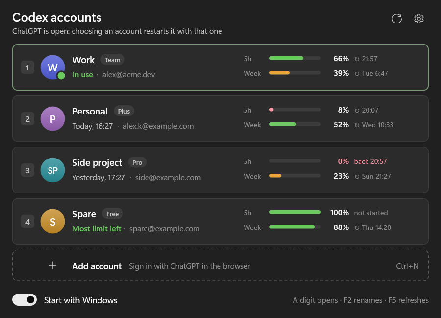
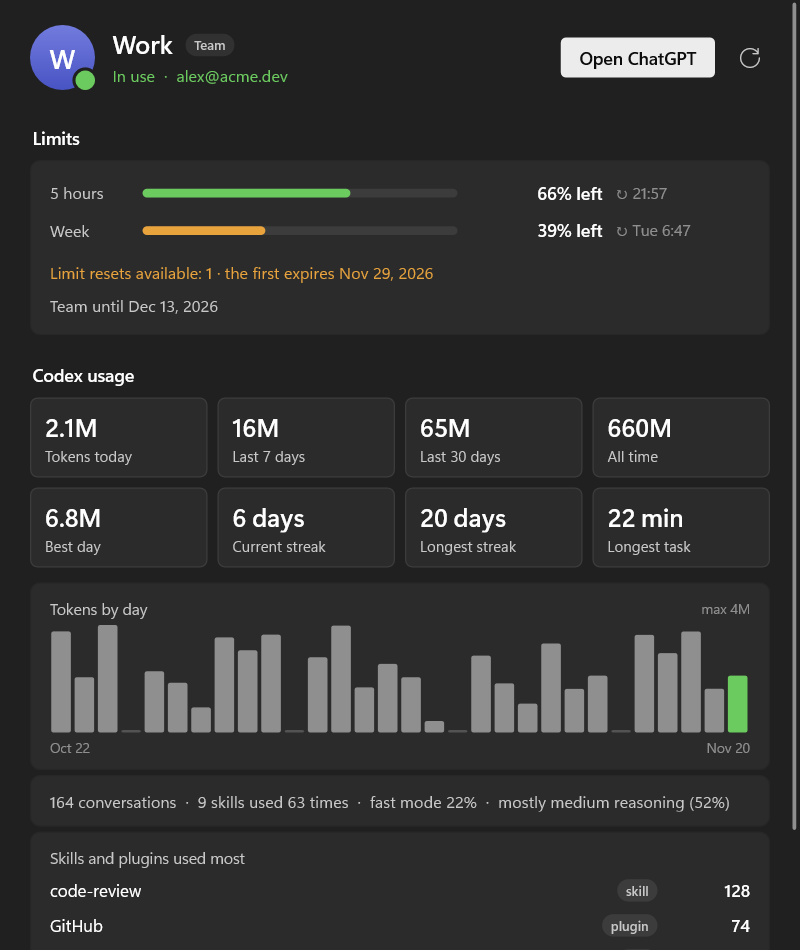
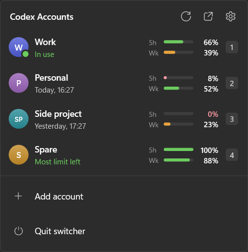
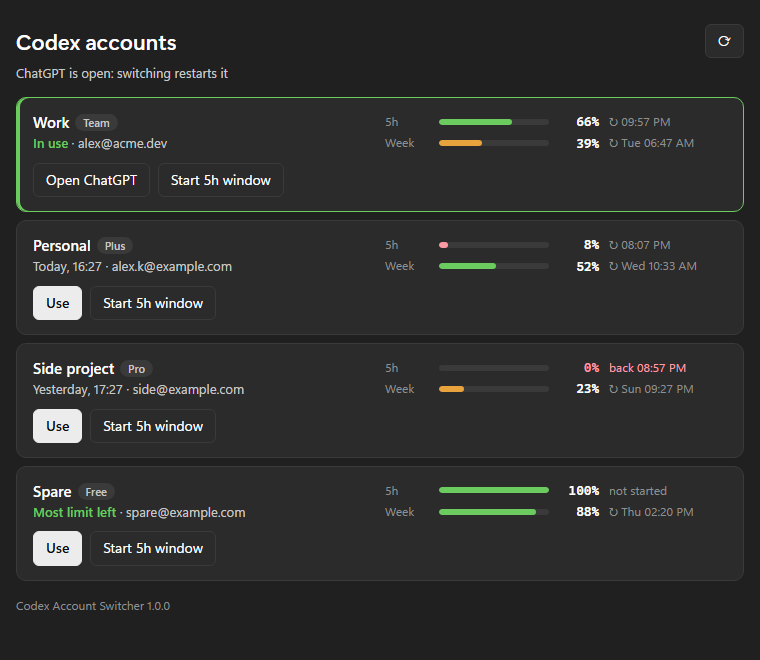

<picture>
  <source media="(prefers-color-scheme: light)" srcset="docs/images/picker-light.png">
  
</picture>

# Codex Account Switcher

**Several Codex accounts on one Windows PC. Pick one, and ChatGPT opens with it; the CLI and VS Code switch too, and every account's limits stay in view.**

&nbsp;

One exe of about 1 MB, nothing else to install · <a href="docs/guide.md">User guide</a> · <a href="docs/how-it-works.md">How it works</a> · <a href="README.ru.md">Русский</a>

Codex keeps one sign-in, so moving to another ChatGPT account means `codex logout`, `codex login` and a trip through the browser every time a limit runs out. Codex Account Switcher keeps the sign-ins of all your accounts and puts the one you pick back into Codex in a second, without signing in again.

- **One shortcut.** <kbd>Ctrl</kbd>+<kbd>Alt</kbd>+<kbd>X</kbd> opens the picker from any app, <kbd>Ctrl</kbd>+<kbd>Shift</kbd>+<kbd>Alt</kbd>+<kbd>1</kbd>…<kbd>9</kbd> switches straight to an account.
- **Limits at a glance.** Each account shows what is left of its 5-hour and weekly limits and when they reset, the way Codex's `/status` does, straight from OpenAI. The one with the most left is marked, one click away.
- **One click opens ChatGPT with the account.** Codex switches to it and the ChatGPT app opens with it (restarting if it was open), VS Code and other editors reconnect, new terminal sessions use it.
- **Picks up where the limit stopped.** Conversations that stopped at the usage limit can get "Continue the previous task." with the new account right after the switch.
- **Statistics per account.** Tokens today, this week and this month, streaks, the longest task, a 30-day chart, the skills and plugins used most, limit resets and when the subscription ends.
- **Start the next window early.** One click, automatically when a window is idle, or every day at times you choose: a tiny request starts an account's 5-hour window, so it resets when you want it.
- **Safe with renewed sign-ins.** ChatGPT replaces a sign-in's key whenever it is renewed. The switcher takes Codex's renewed copy back before every switch, so switching away and back never restores a stale one.
- **Backups and other PCs.** Every account in one password-protected file or line of text. Codex Switcher's exports import too, and its accounts come over in one click.
- **From your phone.** An optional page with the same list, on this PC or your home network, behind a secret link.
- **Small and native.** One C++ exe of about 1 MB, no .NET or Electron, English and Russian, dark and light themes, emails hidden for screen sharing on request. Sign-ins are encrypted with Windows' own protection for your user.

<table>
<tr>
<td width="50%"></td>
<td width="50%"> </td>
</tr>
</table>

## Install

1. Download the exe: [x64](https://github.com/Piwqust/codex-switcher/releases/latest/download/CodexAccountSwitcher-x64.exe) for Intel and AMD (almost every PC) or [ARM64](https://github.com/Piwqust/codex-switcher/releases/latest/download/CodexAccountSwitcher-arm64.exe) for Snapdragon.
2. Run it. It installs itself, without admin rights, and opens the picker. The account Codex is signed in to is already there.
3. Click **Add account** and sign in with your other account in the browser. The sign-in page always asks which account, so a browser signed in to the first one is no obstacle.

You need Windows 10 or 11 and Codex: the [ChatGPT app](https://apps.microsoft.com/search?query=chatgpt) with Codex in it (an older copy is called Codex), the CLI (`npm i -g @openai/codex`) or the VS Code extension. The exe is not code-signed, so the first time Windows may say "Windows protected your PC": click **More info → Run anyway**. Each release lists the SHA-256 of its files to check the download against.

## Using it

| To | Do |
| --- | --- |
| Open ChatGPT with an account | click it or press <kbd>1</kbd>…<kbd>9</kbd> |
| Refresh the limits | <kbd>F5</kbd> or ⟳ |
| See an account's statistics | <kbd>I</kbd>, or **⋯ → Details and statistics** |
| Rename, reorder or delete | <kbd>F2</kbd>, <kbd>Ctrl</kbd>+<kbd>↑</kbd>/<kbd>↓</kbd>, <kbd>Del</kbd>, or the **⋯** menu on an account |
| Hide emails while sharing the screen | Settings → Accounts → **Hide emails** |
| Get to it from any app | <kbd>Ctrl</kbd>+<kbd>Alt</kbd>+<kbd>X</kbd>, or click the tray icon |

A green dot and frame mark the account Codex uses; the line at the top says whether ChatGPT is open (choosing an account restarts it with that one) and how many terminal sessions run. To have a click only switch Codex, without opening ChatGPT, turn off Settings → Switching → **Open ChatGPT when choosing an account**. The **⋯** menu also switches without opening the app, starts an account's 5-hour window, starts it automatically, hides its email, signs it in again, makes a desktop shortcut and saves its `auth.json`. The tray, Settings, backups, the browser page, the command line and troubleshooting are in the **[user guide](docs/guide.md)**.

## How it works

Every Codex, the app, the CLI and the editor extensions, reads its sign-in from `%USERPROFILE%\.codex\auth.json`. The switcher keeps a copy of that file for each account in an encrypted vault, and switching writes the chosen copy back. Before it does, it takes back the copy Codex last renewed, closes ChatGPT if it runs and opens it with the new account. Details, and everything that is and isn't sent anywhere: **[How it works](docs/how-it-works.md)**.

## Compared with Codex Switcher

This is a native rewrite of [Codex Switcher](https://github.com/Lampese/codex-switcher) by [@Lampese](https://github.com/Lampese), in the design of [Claude Profile Switcher](https://github.com/Piwqust/claude-switcher). The sign-in flow, the limits, the statistics, the warm-ups, continuing stopped conversations and the browser page work the same way, its exports import, and its accounts carry over.

| | Codex Switcher | Codex Account Switcher |
| --- | --- | --- |
| Built with | Tauri: Rust and a React web view | C++, Win32, Direct2D, DirectWrite |
| What you install | an installer, plus WebView2 | one exe, about 1 MB |
| Saved sign-ins | a plain JSON file | encrypted for your Windows user (DPAPI) |
| Backups | a password built into the app, the same in every copy | a password you choose (AES-256-GCM) |
| Signing in a second account | the browser may hand back the account it is signed in to | the sign-in page always asks |
| Global shortcuts, jump list, desktop shortcuts per account | — | ✓ |
| Command line | — | switch, list, import, warm up, diagnose |
| Platforms | Windows, macOS, Linux | Windows only |

## Building from source

Visual Studio 2022 or the Build Tools with "Desktop development with C++", then `build.cmd` (or `build.cmd arm64`). Tests: `build.cmd x64 build\x64\Tests.exe test` and `build.cmd x64 build\x64\CompatTests.exe compat`, then run them; `tools\uitest.ps1` clicks through every window in the demo, off screen. The demo over made-up accounts, `tools\demo.ps1`, and the release steps are in [CONTRIBUTING.md](CONTRIBUTING.md).

---

Unofficial: not affiliated with, endorsed by or supported by OpenAI. Codex and ChatGPT are trademarks of OpenAI. It is meant for people who own several accounts themselves; using them is subject to [OpenAI's terms](https://openai.com/policies/terms-of-use/), and sharing accounts is not what it is for. Thanks to @Lampese for Codex Switcher. [MIT license](LICENSE).
