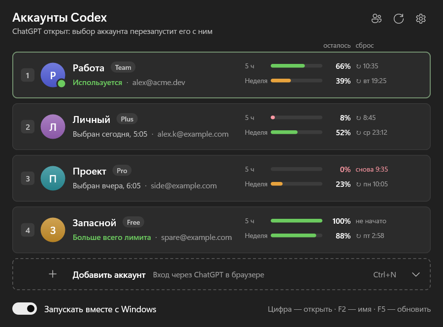
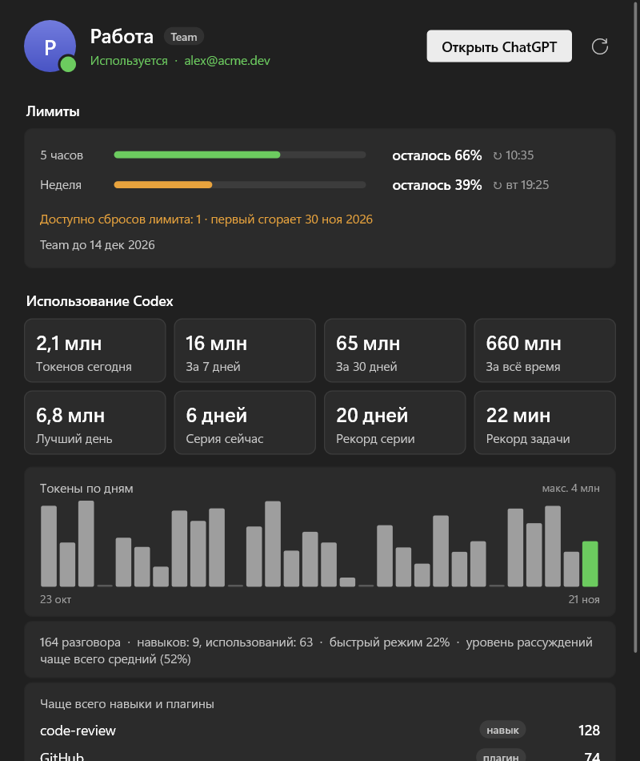
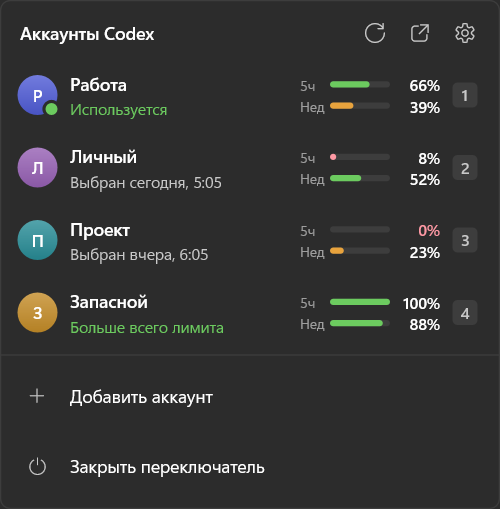
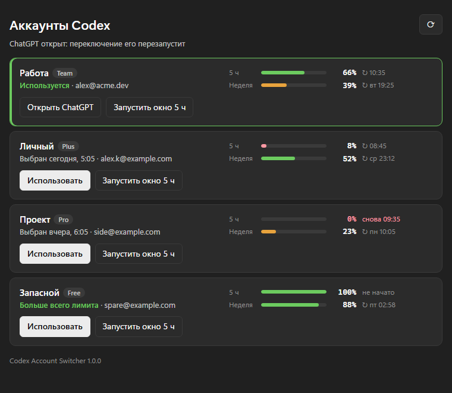

<picture>
  <source media="(prefers-color-scheme: light)" srcset="docs/images/ru/picker-light.png">
  
</picture>

# Codex Account Switcher

**Несколько аккаунтов Codex на одном компьютере с Windows. Выберите аккаунт — и ChatGPT откроется с ним, CLI и VS Code тоже переключатся, а лимиты всех аккаунтов всегда на виду.**

&nbsp;

Один exe размером около 1 МБ, больше ничего ставить не нужно · <a href="docs/guide.ru.md">Руководство</a> · <a href="docs/how-it-works.ru.md">Как это работает</a> · <a href="README.md">English</a>

Codex хранит один вход, поэтому перейти на другой аккаунт ChatGPT — это `codex logout`, `codex login` и браузер каждый раз, когда кончается лимит. Codex Account Switcher хранит входы всех ваших аккаунтов и за секунду возвращает в Codex выбранный, без повторного входа.

- **Одна клавиша.** <kbd>Ctrl</kbd>+<kbd>Alt</kbd>+<kbd>X</kbd> открывает окно выбора из любой программы, <kbd>Ctrl</kbd>+<kbd>Shift</kbd>+<kbd>Alt</kbd>+<kbd>1</kbd>…<kbd>9</kbd> сразу переключает на аккаунт.
- **Лимиты на виду.** У каждого аккаунта видно, сколько осталось от 5-часового и недельного лимита и когда они сбросятся, как в `/status` самого Codex, прямо от OpenAI. Аккаунт, где осталось больше всего, отмечен — до него один клик.
- **Один щелчок открывает ChatGPT с аккаунтом.** Codex переключается на него, а приложение ChatGPT открывается с ним (перезапускается, если было открыто), VS Code и другие редакторы переподключаются, новые сеансы в терминале используют его.
- **Продолжает с места, где встал лимит.** Разговоры, остановленные лимитом, сразу после переключения могут получить «Continue the previous task.» уже с новым аккаунтом.
- **Статистика по аккаунту.** Токены за сегодня, неделю и месяц, серии дней, самая долгая задача, график за 30 дней, самые используемые навыки и плагины, сбросы лимита и дата окончания подписки.
- **Следующее окно — раньше.** Одним кликом, автоматически при простое или каждый день в выбранное время крошечный запрос запускает 5-часовое окно аккаунта, и оно сбрасывается, когда вам нужно.
- **Не теряет продлённые входы.** ChatGPT меняет ключ входа при каждом продлении. Перед каждым переключением программа забирает у Codex продлённую копию, так что переключение туда и обратно никогда не возвращает устаревшую.
- **Купленные аккаунты — от сообщения магазина до готовности.** Управление аккаунтами читает заказ (email, пароль, ключ 2FA, оплаченный месяц и гарантию), показывает код 2FA каждого аккаунта, как приложение-аутентификатор, открывает сайт в отдельном профиле браузера, вводит email, пароль и код по <kbd>Ctrl</kbd>+<kbd>Alt</kbd>+<kbd>V</kbd>, хранит новый пароль и ключ и напоминает о конце гарантии и оплаченного месяца.
- **Резервные копии и другие компьютеры.** Все аккаунты одним файлом или строкой текста под паролем. Экспорт Codex Switcher тоже импортируется, а его аккаунты переносятся в один клик.
- **С телефона.** По желанию — тот же список веб-страницей, на этом компьютере или в домашней сети, по секретной ссылке.
- **Маленький и нативный.** Один exe на C++ размером около 1 МБ, без .NET и Electron, русский и английский, тёмная и светлая темы, email можно скрыть для демонстрации экрана. Входы зашифрованы встроенной защитой Windows для вашего пользователя.

<table>
<tr>
<td width="50%"></td>
<td width="50%"> </td>
</tr>
</table>

## Установка

1. Скачайте exe: [x64](https://github.com/Piwqust/codex-switcher/releases/latest/download/CodexAccountSwitcher-x64.exe) для Intel и AMD (почти все компьютеры) или [ARM64](https://github.com/Piwqust/codex-switcher/releases/latest/download/CodexAccountSwitcher-arm64.exe) для Snapdragon.
2. Запустите его. Он установится сам, без прав администратора, и откроет окно выбора. Аккаунт, в который вошёл Codex, уже будет там.
3. Нажмите **Добавить аккаунт** и войдите в другой аккаунт в браузере. Страница входа всегда спрашивает аккаунт, так что браузер, открытый в первом, не помешает.

Нужны Windows 10 или 11 и Codex: [приложение ChatGPT](https://apps.microsoft.com/search?query=chatgpt) с Codex внутри (старая версия называется Codex), CLI (`npm i -g @openai/codex`) или расширение для VS Code. Exe не подписан, поэтому в первый раз Windows может написать «Система Windows защитила ваш компьютер»: нажмите **Подробнее → Выполнить в любом случае**. В каждом релизе есть SHA-256 его файлов, чтобы проверить загрузку.

## Как пользоваться

| Чтобы | Сделайте |
| --- | --- |
| Открыть ChatGPT с аккаунтом | щёлкните по нему или нажмите <kbd>1</kbd>…<kbd>9</kbd> |
| Обновить лимиты | <kbd>F5</kbd> или ⟳ |
| Посмотреть статистику аккаунта | <kbd>I</kbd> или **⋯ → Подробности и статистика** |
| Переименовать, переставить или удалить | <kbd>F2</kbd>, <kbd>Ctrl</kbd>+<kbd>↑</kbd>/<kbd>↓</kbd>, <kbd>Del</kbd> или меню **⋯** у аккаунта |
| Хранить пароли, коды 2FA и заказы, принимать купленные аккаунты | 👥 в окне выбора или <kbd>Ctrl</kbd>+<kbd>M</kbd>: [управление аккаунтами](docs/guide.ru.md#управление-аккаунтами) |
| Скрыть email на время демонстрации экрана | «Настройки → Аккаунты → **Скрывать email**» |
| Открыть из любой программы | <kbd>Ctrl</kbd>+<kbd>Alt</kbd>+<kbd>X</kbd> или щелчок по значку в трее |

Зелёная точка и рамка отмечают аккаунт, который использует Codex; строка вверху говорит, открыт ли ChatGPT (тогда выбор аккаунта перезапустит его с этим аккаунтом) и сколько сеансов идёт в терминалах. Чтобы щелчок только переключал Codex, не открывая ChatGPT, выключите «Настройки → Переключение → **Открывать ChatGPT с ним**». В меню **⋯** ещё есть: переключить, не открывая приложение, запустить 5-часовое окно аккаунта сейчас или автоматически, скрывать его email, войти заново, ярлык на рабочий стол и сохранение `auth.json`. Трей, настройки, резервные копии, страница в браузере, командная строка и решение проблем — в **[руководстве](docs/guide.ru.md)**.

## Как это работает

Любой Codex — приложение, CLI и расширения редакторов — берёт вход из `%USERPROFILE%\.codex\auth.json`. Переключатель хранит копию этого файла для каждого аккаунта в зашифрованном хранилище, и переключение записывает выбранную копию обратно. Перед этим он забирает копию, которую Codex продлил последней, закрывает ChatGPT, если он открыт, и открывает его с новым аккаунтом. Подробности и всё о том, что куда отправляется и что нет: **[Как это работает](docs/how-it-works.ru.md)**.

## Чем отличается от Codex Switcher

Это нативная переделка [Codex Switcher](https://github.com/Lampese/codex-switcher) от [@Lampese](https://github.com/Lampese) в дизайне [Claude Profile Switcher](https://github.com/Piwqust/claude-switcher). Вход, лимиты, статистика, прогрев, продолжение остановленных разговоров и страница в браузере работают так же, его экспорт импортируется, а аккаунты переносятся.

| | Codex Switcher | Codex Account Switcher |
| --- | --- | --- |
| Сделан на | Tauri: Rust и веб-интерфейс на React | C++, Win32, Direct2D, DirectWrite |
| Что ставится | установщик и WebView2 | один exe, около 1 МБ |
| Сохранённые входы | обычный JSON-файл | зашифрованы для вашего пользователя Windows (DPAPI) |
| Резервные копии | пароль, встроенный в программу, одинаковый во всех копиях | пароль, который выбираете вы (AES-256-GCM) |
| Вход во второй аккаунт | браузер может вернуть аккаунт, в котором уже открыт | страница входа всегда спрашивает |
| Глобальные клавиши, список переходов, ярлыки аккаунтов | — | ✓ |
| Командная строка | — | переключение, список, импорт, прогрев, диагностика |
| Платформы | Windows, macOS, Linux | только Windows |

## Сборка из исходников

Visual Studio 2022 или Build Tools с «Разработкой классических приложений на C++», затем `build.cmd` (или `build.cmd arm64`). Тесты: `build.cmd x64 build\x64\Tests.exe test` и `build.cmd x64 build\x64\CompatTests.exe compat`, затем запустить их; `tools\uitest.ps1` прокликивает все окна в демо, вне экрана. Демо с выдуманными аккаунтами, `tools\demo.ps1`, и выпуск релиза описаны в [CONTRIBUTING.md](CONTRIBUTING.md).

---

Неофициальная программа: не связана с OpenAI, не одобрена и не поддерживается ею. Codex и ChatGPT — товарные знаки OpenAI. Она для тех, у кого несколько собственных аккаунтов; их использование регулируется [условиями OpenAI](https://openai.com/policies/terms-of-use/), а делиться аккаунтами она не предназначена. Спасибо @Lampese за Codex Switcher. [Лицензия MIT](LICENSE).
