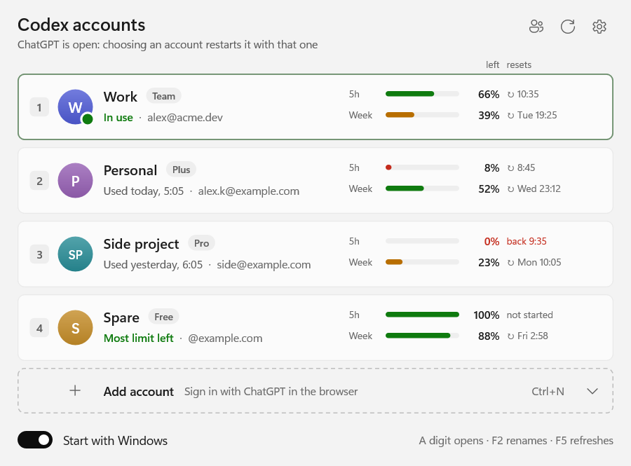
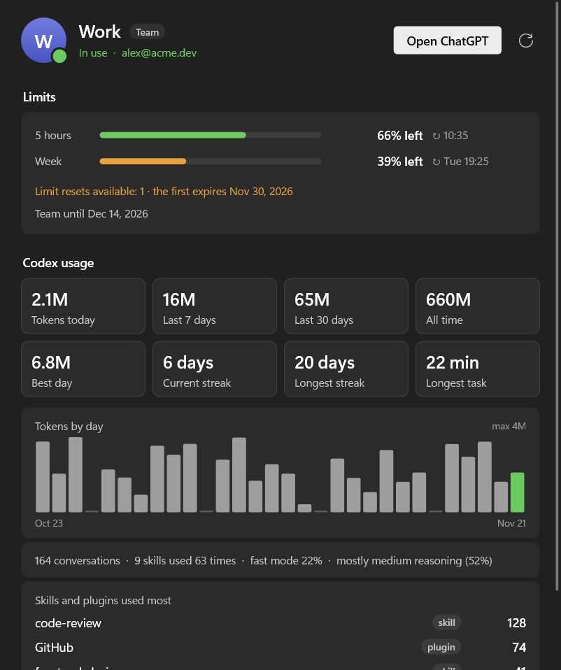
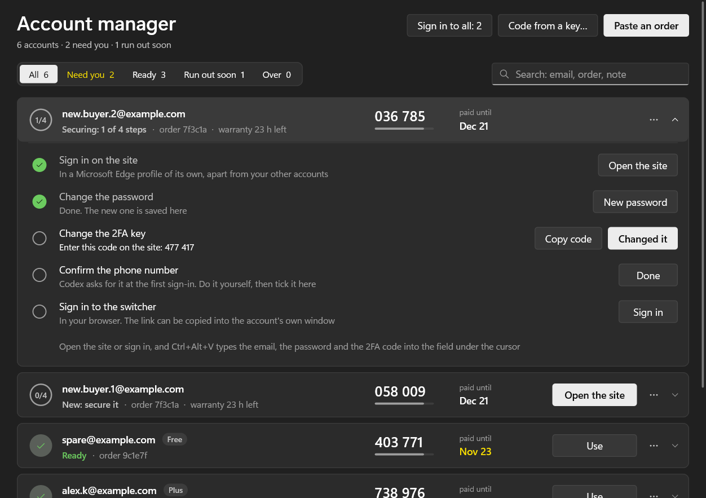
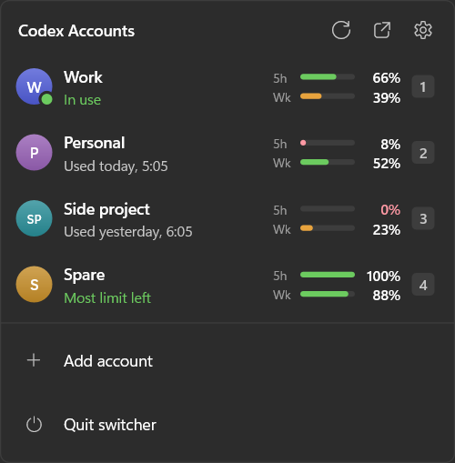
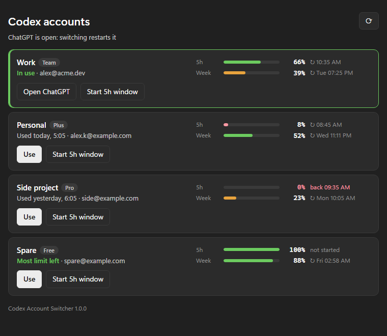
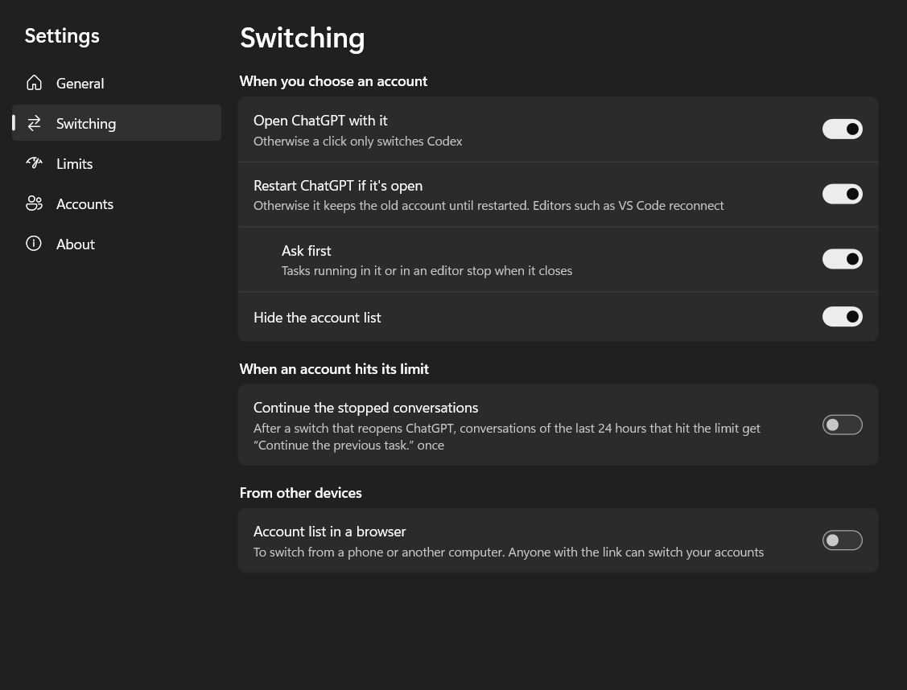

# User guide

Everything Codex Account Switcher can do, in the order you are likely to need it. For the short version, see the [README](../README.md). For what happens under the hood, see [How it works](how-it-works.md).

<sub>[Русский](guide.ru.md)</sub>

- [Install](#install)
- [Adding accounts](#adding-accounts)
- [The picker](#the-picker)
- [Switching](#switching)
- [Continuing conversations the limit stopped](#continuing-conversations-the-limit-stopped)
- [Limits](#limits)
- [Account details and statistics](#account-details-and-statistics)
- [Account manager](#account-manager)
- [Starting 5-hour windows](#starting-5-hour-windows)
- [Tray](#tray)
- [Taskbar and shortcuts](#taskbar-and-shortcuts)
- [Backups and moving to another PC](#backups-and-moving-to-another-pc)
- [Hiding emails](#hiding-emails)
- [In a browser](#in-a-browser)
- [Settings](#settings)
- [Command line](#command-line)
- [Troubleshooting](#troubleshooting)
- [Uninstall](#uninstall)

## Install

1. Download the exe for your processor:

   | Processor | File |
   | --- | --- |
   | Intel or AMD (almost every PC) | [CodexAccountSwitcher-x64.exe](https://github.com/Piwqust/codex-switcher/releases/latest/download/CodexAccountSwitcher-x64.exe) |
   | ARM: Snapdragon, Surface Pro X and the like | [CodexAccountSwitcher-arm64.exe](https://github.com/Piwqust/codex-switcher/releases/latest/download/CodexAccountSwitcher-arm64.exe) |

2. Run it. It installs itself into `%LOCALAPPDATA%\CodexAccounts\.switcher`, adds shortcuts to the desktop and the Start menu, turns on start with Windows and opens the picker. No admin rights needed.

3. You can delete the downloaded file afterwards; the installed copy is what runs from then on.

> [!NOTE]
> The exe is not code-signed, so the first time you run it Windows may say "Windows protected your PC". Click **More info → Run anyway**. To make sure the file is the one built here, compare its hash with `SHA256SUMS.txt` in the release:
>
> ```powershell
> Get-FileHash .\CodexAccountSwitcher-x64.exe -Algorithm SHA256
> ```

**You need** Windows 10 or 11 and Codex in any form: the ChatGPT app from the Microsoft Store (the Codex app is part of it now; an older copy is still called Codex), the CLI or the VS Code extension. They all share one sign-in, which is what the switcher changes.

**Updating:** when a new version is out, click **Update** in the tray list, the tray menu or Settings → About. In a few seconds the new version is running; accounts and settings stay as they were.

## Adding accounts

On first start, the account Codex is signed in to becomes the first account on the list. Then:

- **Add account** (or <kbd>Ctrl</kbd>+<kbd>N</kbd>) opens the ChatGPT sign-in page in your default browser, the same page `codex login` uses. It always asks which account to sign in with, so a second account can be added from a browser that is signed in to the first. While the sign-in waits, the account has a row of its own: **Open again** opens the page once more, ⧉ copies the link to finish it in a private window or any other browser, **Cancel** drops it.
- **The other ways** are behind the ⌄ on the same row: copy the sign-in link without opening anything, paste a shop's order or a line `email|password|2FA key`, take the sign-in Codex uses now, an `auth.json` file, a backup. <kbd>Ctrl</kbd>+<kbd>V</kbd> in the window takes whatever account the clipboard holds, and a file dropped on the window is read the same way.
- **From Codex Switcher.** If you used [Codex Switcher](https://github.com/Lampese/codex-switcher), a banner offers its accounts: **Import** brings them over with their names (also in Settings → Accounts). Its exports, a `.cswf` file or a `css1.` line of text, import with Settings → Accounts → Backup → **Import…**. Afterwards use one switcher, not both: ChatGPT replaces a sign-in's key whenever it is renewed, so two programs renewing the same account sign each other out.
- **From an auth.json file.** Settings → Accounts → Add an account → **From file…** takes a sign-in Codex saved, or one this switcher saved on another PC with **⋯ → Save auth.json…**.
- **From a backup** of this switcher: see [Backups](#backups-and-moving-to-another-pc).
- **Codex is signed in to an account that isn't on the list** (after a `codex login`, say): a banner says so, and **Add it** puts it on the list.

Signing in to an account that is already on the list just gives it the new sign-in. With **Sign in again** on an account, if a different account comes back, the switcher asks whether to try again or add it separately instead of adding it silently.

## The picker



Each row shows the account's number, its name and plan, whether Codex uses it or when it was last used, its email, and what is left of its limits. A green dot and a green frame mark the account in use, and "Most limit left" marks the one worth switching to. The line under the title says whether ChatGPT is open (choosing an account then restarts it with that one) and how many Codex sessions run in terminals.

**A click opens ChatGPT with the account.** Clicking an account switches Codex to it and opens the ChatGPT app with it; clicking the account in use just brings ChatGPT up. To have a click only switch, turn off Settings → Switching → **Open ChatGPT with it**. **Start with Windows** sits at the bottom of the window.

<kbd>I</kbd> opens the [details](#account-details-and-statistics) of the account in focus: limit resets, the subscription and statistics.

The **⋯** menu on a row (or a right-click) has the rest: open ChatGPT with the account, switch to it without opening the app, details and statistics, refresh its limits, start its 5-hour window now or automatically, rename, move, a desktop shortcut, hide its email, sign in again, save its `auth.json`, and delete.

<br clear="right">

| Action | Mouse | Keyboard |
| --- | --- | --- |
| Open ChatGPT with an account | click it | <kbd>1</kbd>…<kbd>9</kbd> or <kbd>Enter</kbd> |
| Refresh limits | ⟳ | <kbd>F5</kbd> (the focused account only, after <kbd>Tab</kbd>) |
| Details and statistics | ⋯ → Details and statistics | <kbd>I</kbd> |
| Add an account | **Add account** | <kbd>Ctrl</kbd>+<kbd>N</kbd> |
| Rename | ⋯ → Rename | <kbd>F2</kbd> |
| Move an account | drag its row, or ⋯ → Move up / down | <kbd>Ctrl</kbd>+<kbd>↑</kbd> / <kbd>↓</kbd> |
| Delete an account | ⋯ → Delete | <kbd>Del</kbd> |
| Bring a deleted account back | **Undo** in the line that appears | <kbd>Ctrl</kbd>+<kbd>Z</kbd> |
| Add whatever the clipboard holds | ⌄ on **Add account** | <kbd>Ctrl</kbd>+<kbd>V</kbd> |
| Account menu | right-click or ⋯ | <kbd>Shift</kbd>+<kbd>F10</kbd> |
| Account manager | 👥 | <kbd>Ctrl</kbd>+<kbd>M</kbd> |
| Settings | ⚙ | <kbd>Ctrl</kbd>+<kbd>,</kbd> |
| Close the window | ✕ | <kbd>Esc</kbd> |
| Move between accounts | | <kbd>Tab</kbd> and the arrow keys |
| Scroll a long list | the wheel, or drag the scroll bar | <kbd>PgUp</kbd> / <kbd>PgDn</kbd>, <kbd>Home</kbd> / <kbd>End</kbd> |

Resting the pointer on an icon button says what it does. Narrator and other screen readers read every window: its rows, buttons and switches have names and can be pressed from there. The windows follow Windows' high contrast colours and its **Animation effects** setting, and Settings, account details and the account manager open where you left them.

From any app: <kbd>Ctrl</kbd>+<kbd>Alt</kbd>+<kbd>X</kbd> for the picker, <kbd>Ctrl</kbd>+<kbd>Shift</kbd>+<kbd>Alt</kbd>+<kbd>1</kbd>…<kbd>9</kbd> to switch directly. You can change the picker's shortcut in Settings → General; if another app already uses it, Settings says so.

## Switching

Picking an account:

1. takes the sign-in Codex renewed back into the account it belongs to;
2. renews the new account's sign-in first if it has expired (and stops, without closing anything, if OpenAI has signed it out);
3. closes the ChatGPT app if it is open, and ends the Codex servers editors such as VS Code run, which they start again by themselves;
4. writes the new account to `auth.json`;
5. opens ChatGPT with the new account. With **Open ChatGPT when choosing an account** off, it opens only if it was open before.

Before closing the app, the switcher asks: tasks running in it stop, and unsent text is lost. Settings can turn the question off, or turn restarting off altogether; then the app keeps the old account until you restart it.

**Terminals.** A `codex` already running in a terminal keeps the account it started with; new sessions use the new one. The notification after a switch says how many are running.

## Continuing conversations the limit stopped

When a limit runs out mid-task, Codex stops with "You've hit your usage limit". After you switch, those conversations can carry on with the new account:

- **Automatically:** turn on Settings → Switching → **Continue the stopped conversations**. A few seconds after a switch that opened the ChatGPT app, the switcher looks through the conversations of the last 24 hours and continues the ones whose last turn ended at the usage limit.
- **By hand:** **Continue conversations stopped by the limit** in the tray's right-click menu, at any time.

Each such conversation gets one message, "Continue the previous task.", queued with the Codex CLI (`codex queue`) and sent when the switcher opens it in the ChatGPT app. A banner in the picker follows the progress and says how many carried on. A conversation is continued at most once, even if you run it again, and conversations you have written in since, or that subagents run, are left alone.

It uses the Codex CLI: the one npm installs (`npm i -g @openai/codex`), or else the copy that comes inside the ChatGPT app. Settings → About shows which one it found.

## Limits

Each account shows what is left of its 5-hour and weekly limits, as Codex's own `/status` puts it, with the time each one resets (↻), and, once a limit is used up, when the account can be used again (in red). A 5-hour window that hasn't started shows 100% and "not started". The account with clearly more left than the one in use is marked "Most limit left", and the tray menu can switch to it in one click. The figures come from OpenAI, asked with each account's own sign-in: when the window opens, and in the background every 15 minutes (Settings can change that). Figures older than half an hour are shown faded.

A plan with only a weekly limit shows "—" for 5 hours. API-key accounts have no plan limits to show.

## Account details and statistics



<kbd>I</kbd> or **⋯ → Details and statistics…** opens a window for one account:

- **Limits:** the 5-hour and weekly windows, the limit resets the account can use and when the first one expires, and the day the subscription renews or ends.
- **Codex usage:** tokens today, in the last 7 and 30 days and in all, the best day, the current and the longest streak of days with Codex, and the longest task.
- **Tokens by day** for the last 30 days, today in green.
- How many conversations, skills used, the share of fast mode and the reasoning effort used most, and the skills and plugins used most.

These are the statistics OpenAI keeps for Codex, asked with the account's own sign-in, as of the time shown at the bottom. <kbd>F5</kbd> or ⟳ asks again.

<br clear="right">

## Account manager

<p align="center">
  
</p>

The 👥 button in the picker (<kbd>Ctrl</kbd>+<kbd>M</kbd>), the tray menu or Settings → Accounts opens a window with every account and its sign-in details: the password, the 2FA key and its current code, the order it came from, and when its paid month and the seller's warranty end. It is meant for accounts bought with a subscription, which arrive as a shop's message and need a few steps before they can be used.

**Taking in an order.** Copy the shop's whole message and press **Paste an order**. The switcher finds the order number, the product (`1M` is a month paid, `W24H` a 24-hour warranty) and every `email|password|2FA key` line; the 2FA key may also be an `otpauth://` or `2fa.live` link. A bare line works too, split by `|`, tabs, `;` or `:`. Pasting the same order again adds nothing, and a later order for the same email only moves its dates on.

**The steps.** A click on an account opens its steps; the circle on the left counts what is done:

1. **Sign in on the site.** **Open the site** opens chatgpt.com in a browser profile of its own for that account (Edge, Chrome, Brave, Vivaldi or Firefox, whichever is your default), so it never mixes with your other accounts, and stays signed in there for next time.
2. **Change the password.** **New password** makes a strong one, copies it and keeps it here. Set it on the site under Settings → Security, then press **Changed it**. The old one is kept aside until then.
3. **Change the 2FA key.** Turn 2FA off and on again on the site, choose to enter the key by hand, and paste it with **Paste the key…**. The code of the new key shows at once, to type on the site; **Changed it** makes it the account's key.
4. **Confirm the phone number.** Codex asks for it at the first sign-in; you do it yourself and tick it here.
5. **Sign in to the switcher.** The usual ChatGPT sign-in, in your default browser; **Copy link** gives the link to paste into the account's own browser window, where the site already knows it. The account joins the list and the card turns green.

**Ctrl+Alt+V types for you.** After **Open the site** or **Sign in**, <kbd>Ctrl</kbd>+<kbd>Alt</kbd>+<kbd>V</kbd> types the email, then the password, then the 2FA code into whatever field has the cursor, each followed by Enter; while changing the password it types the old one and then the new one twice. The card shows what comes next, and a click on a field picks it. Nothing on the sites is clicked for you: you see every page and answer every check yourself.

**2FA codes.** Each account with a key shows its current code with a bar running out to the next one; a click copies it. **Code from a key…** does the same for any key you paste, like 2fa.fb.tools, until the switcher closes. A copied password or code is cleared from the clipboard after 45 seconds, unless you copied something else meanwhile.

**Sign in to all.** With two or more cards not signed in yet, **Sign in to all** opens their sign-in windows one after another: the next one opens when the one before has come back, and **Stop** ends it. You still sign in yourself each time; <kbd>Ctrl</kbd>+<kbd>Alt</kbd>+<kbd>V</kbd> types for the card whose window is open.

**Search.** The field beside the filters (<kbd>Ctrl</kbd>+<kbd>F</kbd>) finds accounts by email, order number or note. The filters then count what the search leaves, and <kbd>Esc</kbd> clears it.

**Keeping track.** The filters show the accounts that need you, the ready ones, the ones whose paid month ends within three days and the ones already over; **Delete all** clears the last. A notification comes two hours before the warranty ends on an account that isn't ready yet, and a day before a paid month ends. The **⋯** menu copies the email, the password or the code, sets a password, a key or a note by hand, switches to the account or deletes it, with or without its place in the switcher's list.

The details are kept in `%LOCALAPPDATA%\CodexAccounts\logins.dat`, encrypted for your Windows user like the accounts, and travel in [backups](#backups-and-moving-to-another-pc). Buying accounts goes against OpenAI's terms, and OpenAI may link and block many accounts used from one PC; that risk stays with you.

## Starting 5-hour windows

A 5-hour window starts with the first request after the previous one ended. **⋯ → Start the 5-hour window now** sends one tiny request ("Hi", the smallest model Codex lists) so it starts now and resets five hours from now, and the tray menu does it for all accounts at once.

The switcher can do it by itself, whenever a window is idle, unless the account's week is used up:

- for every account: Settings → Limits → **When a window is idle**;
- for some accounts only: **⋯ → Start its 5-hour windows automatically** on each of them.

To have windows reset at hours of your choosing, turn on **Every day at set times** in Settings → Limits and set the times, for example `08:00, 13:00, 18:00`. At each, every account's window starts. A time the PC slept through is skipped rather than caught up later. The command line does the same from Task Scheduler: `CodexAccountSwitcher.exe --warmup all`.

## Tray



Closing the window leaves the switcher in the tray, where it opens instantly and keeps the limits and renewed sign-ins current.

- **The icon** is the switcher's own, drawn light on a dark taskbar and dark on a light one. Settings → Limits → **Tray icon** can show what is left of the 5-hour window of the account in use instead (green, amber or red), or hide the icon; <kbd>Ctrl</kbd>+<kbd>Alt</kbd>+<kbd>X</kbd> and the Start menu still open the switcher.
- **Left-click** the icon for the account list with limits. A click on an account there opens ChatGPT with it, as in the main window.
- **Double-click** it to open the main window.
- **Hover** over it: the tooltip names the account in use and its limits.
- **Right-click** it for the standard Windows menu: accounts, the one with the most left, Open ChatGPT, Restart ChatGPT, Refresh limits, Start 5-hour windows for all, Continue conversations stopped by the limit, Add account…, Account manager…, Settings, Quit switcher.
- When a new version is out, an **Update** button appears next to the list's title and in the right-click menu.

If you would rather it quit with the window, turn off **Stay in the tray when the window closes** in Settings → General.

<br clear="right">

## Taskbar and shortcuts

- **Jump list.** Pin the switcher to the taskbar and right-click it to switch from there.
- **Shortcuts.** **⋯ → Desktop shortcut** creates `Codex - <name>`, which switches to that account and opens ChatGPT with it. Pin it to Start or the taskbar.

## Backups and moving to another PC

The vault is encrypted for your Windows user, so copying it to another PC or a reinstalled Windows doesn't work. A backup does:

1. Settings → Accounts → Backup → **Back up…**: **Save to a file…** (a `.casbackup` file) or **Copy as text** (one line starting with `cas1.`).
2. Choose a password of at least 8 characters. Without it the backup can't be opened, and it can't be recovered.
3. On the other PC: **Import…**, the file or the pasted text, then the password.

Every account comes with its sign-in and name, and the account manager's passwords and 2FA keys come too; accounts already there just get the newer sign-in. Keep the backup like a password: it signs in to every account in it.

> [!IMPORTANT]
> A sign-in renewed on one PC stops working on the other (see [Signed out](#troubleshooting)). Moving to a new PC is fine; using the same accounts on two PCs at once means signing in again now and then.

**Import…** also takes Codex Switcher's exports, a `.cswf` file or a `css1.` line, without a password. A `css1.` export holds only the renewable part of each sign-in, so each account is renewed as it comes in.

## Hiding emails

For screen sharing and streams, Settings → Accounts → **Hide emails** shows every email as `jo•••@g•••.com`, and names made from emails the same way, in the picker, the tray, the details and the browser page. **⋯ → Hide its email** does it for one account. Your names for accounts, like "Work", stay as they are.

## In a browser



Settings → Switching → **Account list in a browser** serves the same list as a web page: limits, **Use** to switch, **Start 5h window**, **Open ChatGPT**. It suits a phone, a tablet, or a second computer at the desk.

- Only this PC can open it, at the link in Settings, unless you turn on **Let other devices in**: then anything on your home network or [Tailscale](https://tailscale.com) can. Windows may ask to let the switcher through the firewall.
- The link carries a secret key, and nothing opens without it. **New link** replaces the key, so old links stop working.
- Whoever has the link can switch your accounts and see their emails and limits, never the sign-ins. The page is plain HTTP: allow other devices only on networks you trust.
- The port is 3210; if another program has it, Settings says so.

<br clear="right">

## Settings

<p align="center">
  
</p>

Five pages, picked on the left (<kbd>Ctrl</kbd>+<kbd>Tab</kbd> goes to the next one). An option that only matters when another is on, such as the question before restarting ChatGPT, shows up under it once that one is on. A click anywhere on a switch's row flips it.

- **General:** start with Windows, staying in the tray, the shortcut for the list, <kbd>Ctrl</kbd>+<kbd>Shift</kbd>+<kbd>Alt</kbd>+digit, the theme and the language.
- **Switching:** what choosing an account does (open ChatGPT, restart it if it's open, ask first, hide the list), continuing conversations the limit stopped, and the account list in a browser.
- **Limits:** how often limits refresh, the tray icon, and starting 5-hour windows early: when idle, or every day at set times.
- **Accounts:** adding one (sign in, or an `auth.json` file), Codex Switcher's accounts, backups, hiding emails.
- **About:** the version and updates; the ChatGPT app, the Codex CLI and the sign-in file the switcher found; the folder with the saved accounts.

## Command line

| Command | Does |
| --- | --- |
| `CodexAccountSwitcher.exe` | Opens the picker. Run from anywhere but its install folder, it installs itself first |
| `CodexAccountSwitcher.exe --switch Work` | Switches Codex to an account, then exits. Takes its number, name or email |
| `CodexAccountSwitcher.exe --switch 2 --open` | The same, then opens ChatGPT |
| `CodexAccountSwitcher.exe --warmup all` | Starts the 5-hour window of every account (or of one: `--warmup Work`) |
| `CodexAccountSwitcher.exe --list` | Prints the accounts, the one in use marked with * |
| `CodexAccountSwitcher.exe --diagnose` | Prints what the switcher sees: the app it opens, whether it runs, the Codex CLI and the sign-in file. Changes nothing and prints no emails or sign-ins |
| `CodexAccountSwitcher.exe --import <auth.json>` | Adds the sign-in in that file |
| `CodexAccountSwitcher.exe --import-codex-switcher` | Adds every account from Codex Switcher |
| `CodexAccountSwitcher.exe --add-account` | Opens the browser sign-in for another account |
| `CodexAccountSwitcher.exe --tray` | Starts in the tray only |
| `CodexAccountSwitcher.exe --install` | Installs or refreshes the install, then opens the picker |
| `CodexAccountSwitcher.exe --codex-path "<dir>\Codex.exe"` | Points at the app if it isn't the Store one. The choice is remembered |

With the switcher running, `--switch` goes through it, so its question before closing ChatGPT and its notification apply. With output redirected (`> log.txt`, a pipe), commands print their result and errors instead of showing a window, which suits scripts and Task Scheduler.

## Troubleshooting

<details>
<summary><b>"Codex keeps its sign-in elsewhere"</b></summary>

`config.toml` in your Codex folder says `cli_auth_credentials_store = "keyring"`, so Codex keeps its sign-in in Windows Credential Manager instead of `auth.json`, where the switcher can't follow it. Change the value to `"file"`, sign in to Codex once more, and switching works.
</details>

<details>
<summary><b>ChatGPT doesn't open when I choose an account</b></summary>

Settings → Switching → **Open ChatGPT with it** must be on, and Settings → About must show the app (it says "isn't installed" otherwise). If Windows refuses to start it, the switcher says so and `%LOCALAPPDATA%\CodexAccounts\switcher-error.log` notes why. `CodexAccountSwitcher.exe --diagnose > diagnose.txt` writes down what the switcher sees, for an issue.
</details>

<details>
<summary><b>An account says "Signed out"</b></summary>

OpenAI ended that sign-in: it was signed out on the website, its password changed, or another program renewed the same sign-in (Codex Switcher running at the same time with the same accounts, or the same `auth.json` on another PC). Click **Sign in again** on its row and sign in with that account.
</details>

<details>
<summary><b>"Ports 1455 and 1457 are busy"</b></summary>

Another sign-in is waiting, usually a `codex login` left open in a terminal. Finish or close it (<kbd>Ctrl</kbd>+<kbd>C</kbd>) and click **Add account** again.
</details>

<details>
<summary><b>A conversation wasn't continued</b></summary>

The banner names the first one that wasn't and why. Usually the app didn't start the queued turn within a minute: **Open** shows the conversation, where the message waits in its queue. Running it again never sends a second message to a conversation that already got one.
</details>

<details>
<summary><b>The global shortcut does nothing</b></summary>

Most likely another app already uses it. Settings → General then says "Another app already uses it"; choose a different one there.
</details>

<details>
<summary><b>CODEX_HOME</b></summary>

If you set `CODEX_HOME` for Codex, set it for the switcher too (as a user environment variable, then restart the switcher): it reads and writes `auth.json` in that folder. Settings → About → **Sign-in file** shows which file it uses.
</details>

<details>
<summary><b>Something else</b></summary>

Errors are written to `%LOCALAPPDATA%\CodexAccounts\switcher-error.log`, without tokens. Attach it to an issue.
</details>

## Uninstall

1. Turn off **Start with Windows**, then choose **Quit switcher** in the tray.
2. Delete `%LOCALAPPDATA%\CodexAccounts\.switcher` and the `Codex Account Switcher` and `Codex - …` shortcuts on the desktop and in the Start menu.
3. To remove the saved sign-ins too, delete all of `%LOCALAPPDATA%\CodexAccounts`. Codex itself stays signed in to the account it uses.
