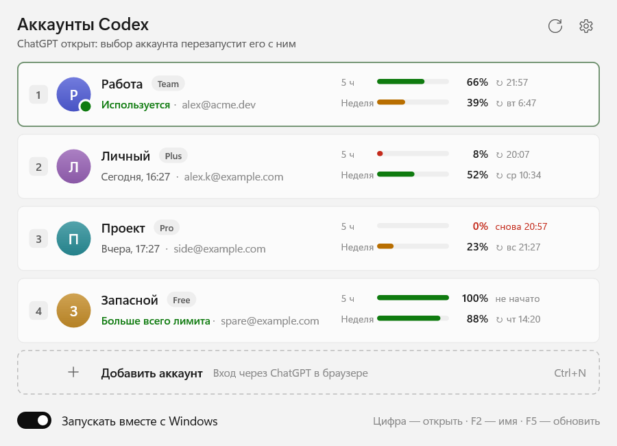
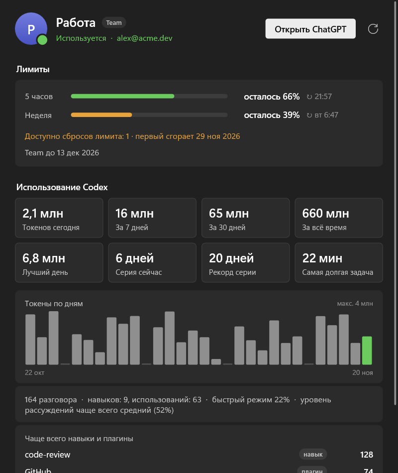
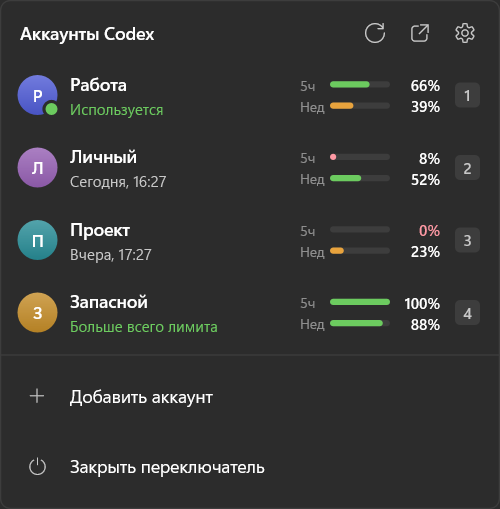
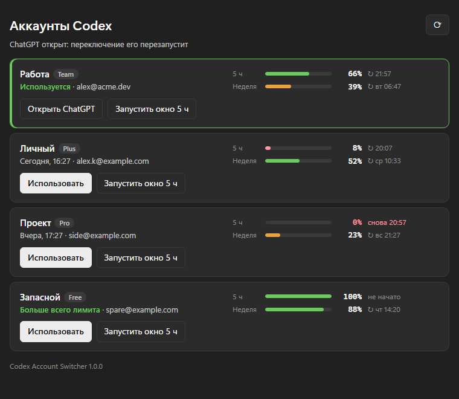
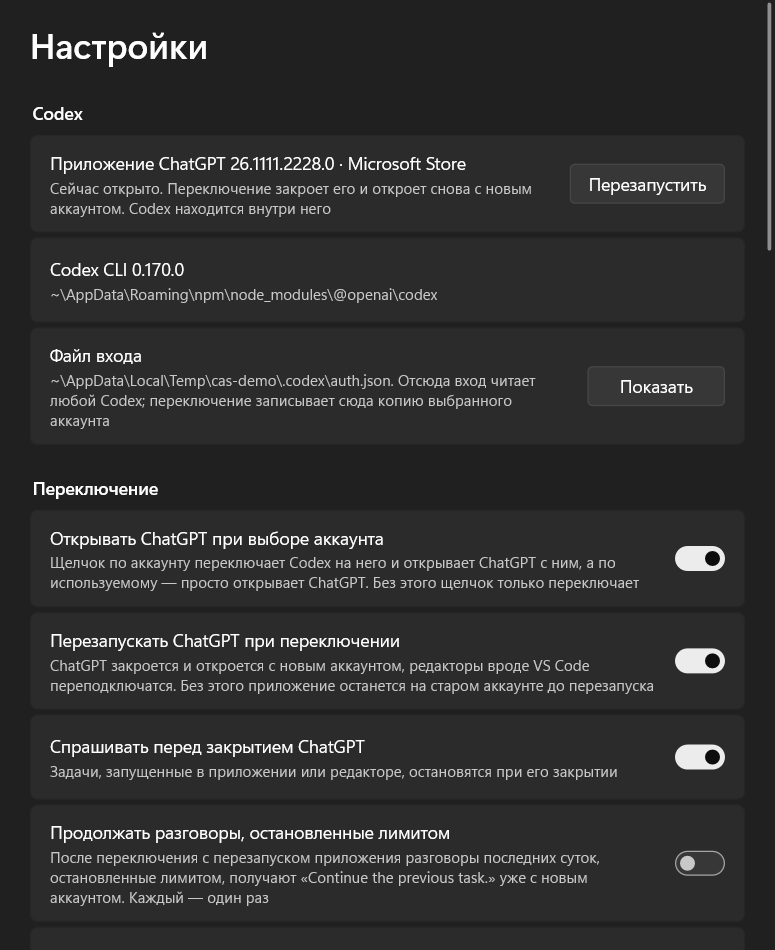

# Руководство

Всё, что умеет Codex Account Switcher, в том порядке, в каком это обычно нужно. Коротко — в [README](../README.ru.md). Что происходит внутри — в «[Как это работает](how-it-works.ru.md)».

<sub>[English](guide.md)</sub>

- [Установка](#установка)
- [Добавление аккаунтов](#добавление-аккаунтов)
- [Окно выбора](#окно-выбора)
- [Переключение](#переключение)
- [Продолжение разговоров, остановленных лимитом](#продолжение-разговоров-остановленных-лимитом)
- [Лимиты](#лимиты)
- [Подробности и статистика аккаунта](#подробности-и-статистика-аккаунта)
- [Запуск 5-часовых окон](#запуск-5-часовых-окон)
- [Трей](#трей)
- [Панель задач и ярлыки](#панель-задач-и-ярлыки)
- [Резервные копии и переезд на другой компьютер](#резервные-копии-и-переезд-на-другой-компьютер)
- [Скрытие email](#скрытие-email)
- [В браузере](#в-браузере)
- [Настройки](#настройки)
- [Командная строка](#командная-строка)
- [Решение проблем](#решение-проблем)
- [Удаление](#удаление)

## Установка

1. Скачайте exe для своего процессора:

   | Процессор | Файл |
   | --- | --- |
   | Intel или AMD (почти все компьютеры) | [CodexAccountSwitcher-x64.exe](https://github.com/Piwqust/codex-switcher/releases/latest/download/CodexAccountSwitcher-x64.exe) |
   | ARM: Snapdragon, Surface Pro X и подобные | [CodexAccountSwitcher-arm64.exe](https://github.com/Piwqust/codex-switcher/releases/latest/download/CodexAccountSwitcher-arm64.exe) |

2. Запустите его. Он установится в `%LOCALAPPDATA%\CodexAccounts\.switcher`, добавит ярлыки на рабочий стол и в меню «Пуск», включит запуск с Windows и откроет окно выбора. Права администратора не нужны.

3. Скачанный файл после этого можно удалить: дальше работает установленная копия.

> [!NOTE]
> Exe не подписан, поэтому при первом запуске Windows может написать «Система Windows защитила ваш компьютер». Нажмите **Подробнее → Выполнить в любом случае**. Чтобы убедиться, что файл собран здесь, сравните его хеш с `SHA256SUMS.txt` в релизе:
>
> ```powershell
> Get-FileHash .\CodexAccountSwitcher-x64.exe -Algorithm SHA256
> ```

**Нужны** Windows 10 или 11 и Codex в любом виде: приложение ChatGPT из Microsoft Store (приложение Codex теперь его часть; старая версия ещё называется Codex), CLI или расширение для VS Code. У них один общий вход, его переключатель и меняет.

**Обновление:** когда выходит новая версия, нажмите **Обновить** в списке в трее, в меню трея или в «Настройки → О программе». Через пару секунд работает новая версия, аккаунты и настройки остаются.

## Добавление аккаунтов

При первом запуске аккаунт, в который вошёл Codex, становится первым в списке. Дальше:

- **Добавить аккаунт** (или <kbd>Ctrl</kbd>+<kbd>N</kbd>) открывает в браузере страницу входа ChatGPT, ту же, что `codex login`. Она всегда спрашивает, какой аккаунт использовать, так что второй аккаунт можно добавить из браузера, открытого в первом. **Ссылка** на баннере даёт адрес для приватного окна или другого браузера.
- **Из Codex Switcher.** Если вы пользовались [Codex Switcher](https://github.com/Lampese/codex-switcher), баннер предложит его аккаунты: **Импорт** перенесёт их с именами (то же есть в «Настройки → Аккаунты»). Его экспорт — файл `.cswf` или строка `css1.` — импортируется через «Настройки → Аккаунты → Резервная копия → **Импорт…**». После этого пользуйтесь одним переключателем, а не обоими: ChatGPT меняет ключ входа при каждом продлении, и две программы, продлевающие один аккаунт, выкидывают друг друга.
- **Из файла auth.json.** «Настройки → Аккаунты → **Выбрать файл…**» принимает вход, сохранённый Codex или этим переключателем на другом компьютере через **⋯ → Сохранить auth.json…**.
- **Из резервной копии** этого переключателя: см. «[Резервные копии](#резервные-копии-и-переезд-на-другой-компьютер)».
- **Codex вошёл в аккаунт, которого нет в списке** (например, после `codex login`): баннер скажет об этом, а **Добавить** внесёт его в список.

Вход в аккаунт, который уже есть в списке, просто обновляет его вход.

## Окно выбора



В каждой строке — номер аккаунта, имя и тариф, используется ли он сейчас или когда использовался последний раз, email и сколько осталось от лимитов. Зелёная точка и рамка отмечают аккаунт, который использует Codex, а «Больше всего лимита» — тот, на который выгодно переключиться. Строка под заголовком говорит, открыт ли ChatGPT (тогда выбор аккаунта перезапустит его с этим аккаунтом) и сколько сеансов Codex идёт в терминалах.

**Щелчок открывает ChatGPT с аккаунтом.** Щелчок по аккаунту переключает Codex на него и открывает приложение ChatGPT с ним, а щелчок по используемому аккаунту просто открывает ChatGPT. Чтобы щелчок только переключал, выключите «Настройки → Переключение → **Открывать ChatGPT при выборе аккаунта**». Внизу окна — переключатель **Запускать вместе с Windows**.

<kbd>I</kbd> открывает [подробности](#подробности-и-статистика-аккаунта) выбранного аккаунта: сбросы лимита, подписку и статистику.

В меню **⋯** у аккаунта (или по правому клику) — остальное: открыть с ним ChatGPT, переключить на него, не открывая приложение, подробности и статистика, обновить лимиты, запустить 5-часовое окно сейчас или автоматически, переименовать, сдвинуть, ярлык на рабочий стол, скрывать его email, войти заново, сохранить `auth.json` и удалить.

<br clear="right">

| Действие | Мышь | Клавиатура |
| --- | --- | --- |
| Открыть ChatGPT с аккаунтом | щелчок по нему | <kbd>1</kbd>…<kbd>9</kbd> или <kbd>Enter</kbd> |
| Обновить лимиты | ⟳ | <kbd>F5</kbd> (только выбранного аккаунта, после <kbd>Tab</kbd>) |
| Подробности и статистика | ⋯ → Подробности и статистика | <kbd>I</kbd> |
| Добавить аккаунт | **Добавить аккаунт** | <kbd>Ctrl</kbd>+<kbd>N</kbd> |
| Переименовать | ⋯ → Переименовать | <kbd>F2</kbd> |
| Переставить аккаунт | ⋯ → Поднять / Опустить | <kbd>Ctrl</kbd>+<kbd>↑</kbd> / <kbd>↓</kbd> |
| Удалить аккаунт | ⋯ → Удалить | <kbd>Del</kbd> |
| Меню аккаунта | правый клик или ⋯ | <kbd>Shift</kbd>+<kbd>F10</kbd> |
| Настройки | ⚙ | <kbd>Ctrl</kbd>+<kbd>,</kbd> |
| Закрыть окно | ✕ | <kbd>Esc</kbd> |
| Перейти между аккаунтами | | <kbd>Tab</kbd> и стрелки |

Из любой программы: <kbd>Ctrl</kbd>+<kbd>Alt</kbd>+<kbd>X</kbd> — окно выбора, <kbd>Ctrl</kbd>+<kbd>Shift</kbd>+<kbd>Alt</kbd>+<kbd>1</kbd>…<kbd>9</kbd> — сразу переключить. Сочетание для окна можно поменять в настройках; если его уже занимает другая программа, настройки скажут об этом.

## Переключение

Выбор аккаунта:

1. забирает вход, который продлил Codex, в аккаунт, которому он принадлежит;
2. сначала продлевает вход нового аккаунта, если он истёк (и останавливается, ничего не закрывая, если OpenAI этот вход завершил);
3. закрывает приложение ChatGPT, если оно открыто, и завершает серверы Codex, которые запускают редакторы вроде VS Code (они сами запускают их снова);
4. записывает новый аккаунт в `auth.json`;
5. открывает ChatGPT с новым аккаунтом. Если «Открывать ChatGPT при выборе аккаунта» выключено — только когда он был открыт.

Перед закрытием приложения переключатель спрашивает: запущенные в нём задачи остановятся, неотправленный текст пропадёт. В настройках вопрос можно отключить или отключить перезапуск совсем; тогда приложение останется на старом аккаунте до перезапуска.

**Терминалы.** Уже запущенный в терминале `codex` остаётся на аккаунте, с которым стартовал, новые сеансы берут новый. Уведомление после переключения говорит, сколько их запущено.

## Продолжение разговоров, остановленных лимитом

Когда лимит кончается посреди задачи, Codex останавливается с «You've hit your usage limit». После переключения такие разговоры могут продолжиться уже с новым аккаунтом:

- **Автоматически:** включите «Настройки → Переключение → **Продолжать разговоры, остановленные лимитом**». Через несколько секунд после переключения, открывшего приложение ChatGPT, переключатель просматривает разговоры за последние сутки и продолжает те, чей последний ход упёрся в лимит.
- **Вручную:** **Продолжить разговоры, остановленные лимитом** в меню трея по правому клику, в любой момент.

Каждый такой разговор получает одно сообщение «Continue the previous task.»: оно ставится в очередь через Codex CLI (`codex queue`) и уходит, когда переключатель открывает разговор в приложении ChatGPT. Баннер в окне выбора показывает ход и сколько разговоров продолжилось. Разговор продолжается не больше одного раза, даже при повторном запуске, а разговоры, в которые вы с тех пор писали, и разговоры субагентов не трогаются.

Для этого используется Codex CLI: установленный через npm (`npm i -g @openai/codex`), а если его нет — копия внутри приложения ChatGPT. Какой найден, видно в «Настройки → Codex».

## Лимиты

У каждого аккаунта видно, сколько осталось от 5-часового и недельного лимита — как в `/status` самого Codex — и когда каждый сбросится (↻), а когда лимит исчерпан — когда аккаунтом снова можно пользоваться (красным). Не начатое 5-часовое окно показывает 100% и «не начато». Аккаунт, где осталось заметно больше, чем у используемого, отмечен «Больше всего лимита», и меню трея переключает на него в один клик. Цифры приходят от OpenAI, запрос идёт с собственным входом каждого аккаунта: при открытии окна и в фоне раз в 15 минут (в настройках можно поменять). Цифры старше получаса показаны бледнее.

У тарифа только с недельным лимитом для 5 часов стоит «—». У аккаунтов с API-ключом лимитов подписки нет.

## Подробности и статистика аккаунта



<kbd>I</kbd> или **⋯ → Подробности и статистика…** открывают окно одного аккаунта:

- **Лимиты:** 5-часовое и недельное окна, доступные сбросы лимита и когда сгорает первый, дата продления или окончания подписки.
- **Использование Codex:** токены за сегодня, за 7 и 30 дней и за всё время, лучший день, текущая и самая длинная серия дней с Codex, самая долгая задача.
- **Токены по дням** за последние 30 дней, сегодня — зелёным.
- Сколько разговоров, использованных навыков, доля быстрого режима и чаще всего выбираемый уровень рассуждений, а также навыки и плагины, которые используются чаще всего.

Это статистика, которую OpenAI ведёт для Codex; запрос идёт с собственным входом аккаунта, время данных указано внизу. <kbd>F5</kbd> или ⟳ запрашивают заново.

<br clear="right">

## Запуск 5-часовых окон

5-часовое окно начинается с первого запроса после окончания предыдущего. **⋯ → Запустить 5-часовое окно сейчас** отправляет один крошечный запрос («Hi», самой маленькой модели из списка Codex), и окно начинается сейчас и сбросится через пять часов; меню трея делает это для всех аккаунтов сразу.

Переключатель может делать это сам, как только окно простаивает, если неделя аккаунта не исчерпана:

- для всех аккаунтов: «Настройки → Лимиты → **Запускать 5-часовые окна автоматически**»;
- только для некоторых: **⋯ → Автоматически запускать его 5-часовые окна** у каждого из них.

Чтобы окна сбрасывались в выбранные часы, включите **Запускать в заданное время** в «Настройки → Лимиты» и задайте время, например `08:00, 13:00, 18:00`. В каждое из них запускаются окна всех аккаунтов. Время, которое компьютер проспал, пропускается, а не догоняется позже. Из Планировщика заданий то же делает командная строка: `CodexAccountSwitcher.exe --warmup all`.

## Трей



После закрытия окна переключатель остаётся в трее: открывается мгновенно и держит лимиты и продлённые входы актуальными.

- **Значок** — собственный значок переключателя: светлый на тёмной панели задач и тёмный на светлой. «Настройки → Лимиты → **Значок в трее**» может вместо него показывать, сколько осталось в 5-часовом окне используемого аккаунта (зелёным, жёлтым или красным), или спрятать значок; <kbd>Ctrl</kbd>+<kbd>Alt</kbd>+<kbd>X</kbd> и меню «Пуск» всё равно открывают переключатель.
- **Щелчок** по значку — список аккаунтов с лимитами. Щелчок по аккаунту в нём открывает ChatGPT с этим аккаунтом, как и в главном окне.
- **Двойной щелчок** — главное окно.
- **Наведение** — подсказка с аккаунтом, который используется, и его лимитами.
- **Правый клик** — обычное меню Windows: аккаунты, самый свободный аккаунт, «Открыть ChatGPT», «Перезапустить ChatGPT», «Обновить лимиты», «Запустить 5-часовые окна у всех», «Продолжить разговоры, остановленные лимитом», «Добавить аккаунт…», «Настройки», «Закрыть переключатель».
- Когда выходит новая версия, кнопка **Обновить** появляется рядом с заголовком списка и в меню по правому клику.

Если хотите, чтобы он закрывался вместе с окном, выключите **Оставаться в трее после закрытия окна** в настройках.

<br clear="right">

## Панель задач и ярлыки

- **Список переходов.** Закрепите переключатель на панели задач и переключайтесь правым кликом по нему.
- **Ярлыки.** **⋯ → Ярлык на рабочий стол** создаёт `Codex - <имя>`: он переключает на этот аккаунт и открывает с ним ChatGPT. Его можно закрепить в «Пуске» или на панели задач.

## Резервные копии и переезд на другой компьютер

Хранилище зашифровано для вашего пользователя Windows, поэтому его копия на другом компьютере или после переустановки Windows не откроется. Резервная копия — откроется:

1. «Настройки → Аккаунты → Резервная копия → **Сохранить…**»: **Сохранить в файл…** (файл `.casbackup`) или **Скопировать текстом** (одна строка, начинается с `cas1.`).
2. Придумайте пароль не короче 8 символов. Без него копию не открыть, и восстановить его нельзя.
3. На другом компьютере: **Импорт…**, файл или вставленный текст, затем пароль.

Каждый аккаунт переносится со входом и именем; аккаунты, которые там уже есть, просто получают более новый вход. Храните копию как пароль: она входит во все аккаунты в ней.

> [!IMPORTANT]
> Вход, продлённый на одном компьютере, перестаёт работать на другом (см. «[Сеанс завершён](#решение-проблем)»). Переезд на новый компьютер — нормально; пользоваться одними и теми же аккаунтами на двух компьютерах одновременно — значит время от времени входить заново.

**Импорт…** принимает и экспорт Codex Switcher — файл `.cswf` или строку `css1.` — без пароля. В экспорте `css1.` есть только продлеваемая часть каждого входа, поэтому каждый аккаунт при импорте продлевается.

## Скрытие email

Для демонстрации экрана и стримов «Настройки → Аккаунты → **Скрывать email**» показывает каждый email как `jo•••@g•••.com`, и так же — имена, сделанные из email: в окне выбора, в трее, в подробностях и на странице в браузере. **⋯ → Скрывать его email** делает это для одного аккаунта. Ваши имена аккаунтов вроде «Работа» остаются как есть.

## В браузере



«Настройки → В браузере → **Список аккаунтов в браузере**» отдаёт тот же список веб-страницей: лимиты, **Использовать** для переключения, **Запустить окно 5 ч**, **Открыть ChatGPT**. Подходит для телефона, планшета или второго компьютера на столе.

- Открыть её может только этот компьютер по ссылке из настроек, пока не включено **Пускать другие устройства**: тогда может всё в вашей домашней сети или в [Tailscale](https://tailscale.com). Windows может спросить разрешение для брандмауэра.
- В ссылке есть секретный ключ, без него ничего не открывается. **Новая ссылка** меняет ключ, и старые ссылки перестают работать.
- Тот, у кого есть ссылка, может переключать ваши аккаунты и видит их email и лимиты, но никогда не входы. Страница работает по обычному HTTP: пускайте другие устройства только в сетях, которым доверяете.
- Порт — 3210; если его занимает другая программа, настройки скажут об этом.

<br clear="right">

## Настройки

<p align="center">
  
</p>

- **Codex:** приложение ChatGPT и его версия (с кнопкой **Открыть** или **Перезапустить**), Codex CLI и где он, какой файл входа использует Codex.
- **Переключение:** открытие ChatGPT при выборе аккаунта, его перезапуск и вопрос перед ним, продолжение разговоров, остановленных лимитом, скрытие окна после переключения.
- **Лимиты:** как часто обновлять лимиты, значок в трее, автоматические 5-часовые окна и время их запуска.
- **Аккаунты:** вход, файлы `auth.json`, Codex Switcher, резервные копии, скрытие email.
- **В браузере:** веб-страница и кого на неё пускать.
- **Запуск и вид:** запуск с Windows, трей, тема (системная, светлая или тёмная).
- **Быстрый доступ, Язык, О программе:** горячие клавиши, список переходов, язык интерфейса, папка данных и обновления.

## Командная строка

| Команда | Что делает |
| --- | --- |
| `CodexAccountSwitcher.exe` | Открывает окно выбора. Запущенный не из папки установки сначала устанавливается |
| `CodexAccountSwitcher.exe --switch Work` | Переключает Codex на аккаунт и выходит. Принимает номер, имя или email |
| `CodexAccountSwitcher.exe --switch 2 --open` | То же, и открывает ChatGPT |
| `CodexAccountSwitcher.exe --warmup all` | Запускает 5-часовые окна всех аккаунтов (или одного: `--warmup Work`) |
| `CodexAccountSwitcher.exe --list` | Печатает аккаунты, используемый отмечен * |
| `CodexAccountSwitcher.exe --diagnose` | Печатает, что видит переключатель: какое приложение он открывает, запущено ли оно, Codex CLI и файл входа. Ничего не меняет, email и входы не печатает |
| `CodexAccountSwitcher.exe --import <auth.json>` | Добавляет вход из этого файла |
| `CodexAccountSwitcher.exe --import-codex-switcher` | Добавляет все аккаунты из Codex Switcher |
| `CodexAccountSwitcher.exe --add-account` | Открывает вход в браузере для ещё одного аккаунта |
| `CodexAccountSwitcher.exe --tray` | Запускается только в трее |
| `CodexAccountSwitcher.exe --install` | Устанавливает или обновляет установку, затем открывает окно выбора |
| `CodexAccountSwitcher.exe --codex-path "<папка>\Codex.exe"` | Указывает приложение, если это не версия из Store. Выбор запоминается |

Когда переключатель запущен, `--switch` идёт через него, поэтому его вопрос перед закрытием ChatGPT и уведомление тоже работают. С перенаправленным выводом (`> log.txt`, конвейер) команды печатают результат и ошибки вместо окна — так удобно для скриптов и Планировщика заданий.

## Решение проблем

<details>
<summary><b>«Codex хранит вход в другом месте»</b></summary>

В `config.toml` в папке Codex указано `cli_auth_credentials_store = "keyring"`, поэтому Codex хранит вход в диспетчере учётных данных Windows, а не в `auth.json`, куда переключатель может писать. Поставьте `"file"`, войдите в Codex ещё раз — и переключение заработает.
</details>

<details>
<summary><b>ChatGPT не открывается при выборе аккаунта</b></summary>

Должно быть включено «Настройки → Переключение → **Открывать ChatGPT при выборе аккаунта**», а «Настройки → Codex» должны показывать приложение (иначе там написано «не установлено»). Если Windows отказывается его запускать, переключатель об этом скажет, а причина запишется в `%LOCALAPPDATA%\CodexAccounts\switcher-error.log`. `CodexAccountSwitcher.exe --diagnose > diagnose.txt` запишет, что видит переключатель, — приложите к issue.
</details>

<details>
<summary><b>У аккаунта «Сеанс завершён»</b></summary>

OpenAI завершил этот вход: из аккаунта вышли на сайте, сменили пароль или тот же вход продлила другая программа (Codex Switcher, запущенный одновременно с теми же аккаунтами, или тот же `auth.json` на другом компьютере). Нажмите **Войти заново** в его строке и войдите в этот аккаунт.
</details>

<details>
<summary><b>«Порты 1455 и 1457 заняты»</b></summary>

Ждёт другой вход, обычно забытый в терминале `codex login`. Завершите или закройте его (<kbd>Ctrl</kbd>+<kbd>C</kbd>) и снова нажмите **Добавить аккаунт**.
</details>

<details>
<summary><b>Разговор не продолжился</b></summary>

Баннер называет первый такой разговор и причину. Обычно приложение не начало ход из очереди за минуту: **Открыть** покажет разговор, где сообщение ждёт в очереди. Повторный запуск никогда не отправит второе сообщение в разговор, который уже его получил.
</details>

<details>
<summary><b>Горячая клавиша ничего не делает</b></summary>

Скорее всего, её уже занимает другая программа. Тогда настройки пишут «Это сочетание занято другой программой»; выберите там другое.
</details>

<details>
<summary><b>CODEX_HOME</b></summary>

Если вы задали `CODEX_HOME` для Codex, задайте его и для переключателя (как переменную среды пользователя, затем перезапустите переключатель): он читает и пишет `auth.json` в этой папке. «Настройки → Codex → **Файл входа**» показывает, какой файл он использует.
</details>

<details>
<summary><b>Что-то другое</b></summary>

Ошибки пишутся в `%LOCALAPPDATA%\CodexAccounts\switcher-error.log`, без токенов. Приложите его к issue.
</details>

## Удаление

1. Выключите **Запускать вместе с Windows**, затем выберите **Закрыть переключатель** в трее.
2. Удалите `%LOCALAPPDATA%\CodexAccounts\.switcher` и ярлыки `Codex Account Switcher` и `Codex - …` на рабочем столе и в меню «Пуск».
3. Чтобы удалить и сохранённые входы, удалите всю папку `%LOCALAPPDATA%\CodexAccounts`. Сам Codex останется в аккаунте, который использует.
