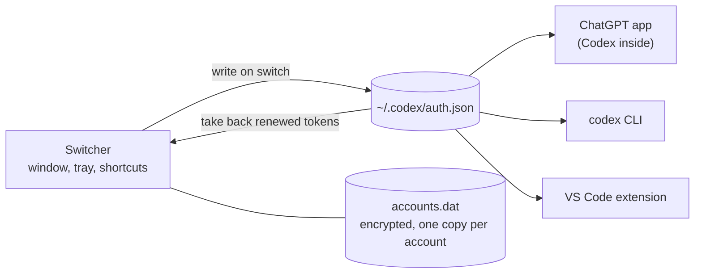

# How it works

What the switcher does to move Codex between accounts, what it leaves alone, and what it sends where. For using it, see the [user guide](guide.md).

[Русский](how-it-works.ru.md)

- [The idea](#the-idea)
- [Renewed sign-ins](#renewed-sign-ins)
- [Step by step](#step-by-step)
- [Signing in](#signing-in)
- [Limits, statistics and warm-ups](#limits-statistics-and-warm-ups)
- [Continuing stopped conversations](#continuing-stopped-conversations)
- [Backups](#backups)
- [The browser page](#the-browser-page)
- [Security and privacy](#security-and-privacy)
- [What is shared between accounts](#what-is-shared-between-accounts)

## The idea

Every Codex, the desktop app, the CLI and the editor extensions, reads its sign-in from one file: `auth.json` in `%USERPROFILE%\.codex` (or in `CODEX_HOME`). It holds the ChatGPT tokens of one account. The switcher keeps a copy of that file for each of your accounts and, to switch, writes the chosen copy back.

## Renewed sign-ins

ChatGPT renews a sign-in by replacing its refresh token, and the old one stops working; using an old one again can end the whole sign-in. Codex renews the sign-in it uses by itself and rewrites `auth.json`. So the copy in `auth.json` is the newest one for its account, and a copy the switcher saved earlier may already be dead.

The switcher therefore takes that copy back into the vault before every switch, every time it looks (every 2 seconds while a window is open, every 20 from the tray), and before it asks OpenAI anything. A copy is taken only if it isn't older than the saved one, so a Codex that still runs with an old sign-in can't overwrite a newer one. And it never renews the sign-in Codex is using while any Codex runs: that would leave Codex with a dead token.

## Step by step

1. **Finds the app.** The Store package `OpenAI.Codex` through the per-user package repository in the registry. Its app is now ChatGPT (`app\ChatGPT.exe`), with Codex inside; an older copy is `Codex.exe`. A different exe can be pointed at with `--codex-path`.
2. **Keeps accounts.** `%LOCALAPPDATA%\CodexAccounts\accounts.dat` holds each account's `auth.json`, name, email, plan and ids, encrypted. Settings and the last limits seen are in `settings.json` and `usage.json` next to it.
3. **Knows which account is in use** by the ChatGPT workspace and user ids in the tokens of `auth.json`, so the same email in two workspaces is two accounts.
4. **Switches.** Takes the renewed copy back; renews the new account first if its token has expired; closes the app's process tree if it runs and ends the app servers editors run (they restart themselves); writes `auth.json` (to a temporary file, then swapped in, so it is never half-written); opens the app with the new account through its package, as the Start menu does (or only if it was open, when Settings say so).
5. **Watches.** A process snapshot shows the app, terminal sessions and editor servers, without WMI or PowerShell.

## Signing in

**Add** does what `codex login` does: a one-off server on `localhost:1455` (or 1457, the two ports OpenAI accepts for Codex), and the browser sent to `auth.openai.com` with a PKCE challenge. Only an answer carrying that sign-in's random `state` is accepted; the one-time code is exchanged for tokens over HTTPS and the server closes. One addition: `prompt=login`, so the page always asks which account, rather than handing back the one the browser is signed in to.

## Limits, statistics and warm-ups

Every request below goes to OpenAI with that account's own access token and the headers Codex sends (`ChatGPT-Account-Id`, `originator: codex_cli_rs`).

- **Limits** come from `GET https://chatgpt.com/backend-api/wham/usage`, the request Codex's `/status` makes. The answer gives the 5-hour and weekly windows, how much of each is used, when each resets, and how many limit resets the account has. When it has some, `GET …/wham/rate-limit-reset-credits` tells when the first one expires.
- **Statistics** are `GET …/wham/profiles/me`, the figures Codex keeps per account: tokens by day, streaks, the longest task, conversations, skills and plugins. `GET …/accounts/check/v4-2023-04-27` adds the plan and the day the subscription renews or ends. They are asked only when a details window opens.
- **A warm-up** is one request to `https://chatgpt.com/backend-api/codex/responses` saying "Hi" to the smallest model Codex lists, with low reasoning effort and nothing stored. The first request after a window ends starts the next one. Set times are checked every half minute; one that passed more than two minutes ago, while the PC slept, is skipped.
- **Renewing** a sign-in is `POST https://auth.openai.com/oauth/token`, the same request Codex makes, only for accounts Codex isn't using, or when no Codex runs.

## Continuing stopped conversations

Codex writes every conversation to a log in `.codex\sessions\YYYY\MM\DD\rollout-*.jsonl`. The switcher reads the logs changed in the last 24 hours, each one's first line and last 2 MB (it never writes them), and picks the conversations whose last turn ended with Codex's own usage-limit error: an error event with `usage_limit_exceeded`, or a failed turn whose message starts "You've hit your usage limit". The same words quoted in a message or tool output don't count, a conversation you wrote in since is skipped, and so are subagents, which their parent conversation drives.

For each, up to 32 and newest first:

1. a receipt goes to `%LOCALAPPDATA%\CodexAccounts\recovery\<conversation>.json` *before* anything is sent, so a crash or a second run can't send the message twice;
2. `codex queue --thread <id> --message …` queues "Continue the previous task." with a last line `[Codex Account Switcher recovery: <random id>]` that makes this one message recognizable; the CLI runs without a window and is stopped after 10 seconds;
3. `codex://threads/<id>` opens the conversation in the ChatGPT app, which sends what is queued;
4. the log is watched for a new turn carrying that exact message, for up to a minute (two minutes for all of them).

The receipt goes once the turn shows. A conversation whose message stayed queued is reported, not queued again, unless you have written in it since; one whose log can't be read any more keeps its receipt. If the CLI surely didn't queue the message (it couldn't start, or it failed), the receipt goes and nothing is waited for. A switch, or quitting the switcher, stops a run at its next step.

## Backups

**Back up…** writes every account (its `auth.json`, name and when it was last used) as JSON, encrypted:

| Bytes | |
| --- | --- |
| 4 | `CASB` |
| 1 | format version, 1 |
| 4 | PBKDF2 iterations, little-endian: 600 000 |
| 16 | salt, random |
| 12 | nonce, random |
| rest | AES-256-GCM ciphertext and its 16-byte tag |

The key is PBKDF2-HMAC-SHA256 of your password (UTF-8) and the salt; Windows' BCrypt does both. **Copy as text** is the same bytes as `cas1.` and base64url. Nothing in the file says which accounts it holds, and a wrong password or a changed byte fails the tag check rather than giving garbage.

Codex Switcher's own exports are read too: its `.cswf` files (XChaCha20-Poly1305 with the passphrase built into Codex Switcher, then zlib) and its `css1.` text (zlib JSON with each account's name and refresh token, which the switcher renews to get the rest).

## The browser page

Off by default. When on, a small HTTP server listens on `127.0.0.1:3210`, or on every network interface with **Allow other devices**. Every request must carry the key from the link (`?key=…`, 24 random characters, compared in constant time), or it gets 401. The page and its data:

- `GET /` is the page, served with a Content-Security-Policy that loads nothing from elsewhere, `X-Frame-Options: DENY` and no caching;
- `GET /api/state` is the list: names, emails (hidden when emails are), plans, limits, which account is in use. Never a token;
- `POST /api/switch`, `/api/refresh`, `/api/warmup`, `/api/open` do what the buttons in the window do. They need POST, so a link or an image on another site can't trigger them, and the key, which other sites can't know.

The page is plain HTTP: on a network you don't trust, someone who can watch the traffic could take the link. **New link** replaces the key.

## Security and privacy

- **Encrypted at rest.** The vault is encrypted with Windows' DPAPI for your user, with an entropy of the switcher's own. Another Windows user, or the file copied to another PC, can't read it. A vault that can't be read is moved aside, never overwritten.
- **Tokens go only to OpenAI**, over HTTPS, to the addresses above, with redirects refused. The error log never contains them, and neither the browser page nor `codex queue` ever gets one.
- **No telemetry.** The only other request is the update check: the latest release's version from `api.github.com`, at start and every 6 hours (Settings → About can turn it off). An update is installed only when you click **Update** and its SHA-256 matches the release's `SHA256SUMS.txt`.
- **Codex is not modified.** Only `auth.json` is written; `config.toml`, history, sessions and everything else in the Codex folder are left alone. Continuing conversations reads the session logs and adds a message through Codex's own CLI.
- **No admin rights.** Everything goes into your profile: `%LOCALAPPDATA%\CodexAccounts`, `auth.json`, shortcuts, and an `HKCU\…\Run` value for start with Windows.
- **Nothing listens by default.** The sign-in server lives only while a sign-in waits; the browser page only when you turn it on.
- **Save auth.json** and **Back up…** write sign-ins to a file on purpose: the first in the clear after asking, the second under your password. Treat both as passwords.

Found a vulnerability? See [SECURITY.md](../SECURITY.md).

## What is shared between accounts

Only the sign-in changes. Everything else in the Codex folder is one set for every account: `config.toml`, MCP servers, skills, prompts, history and sessions. A conversation started with one account can be continued with another.
