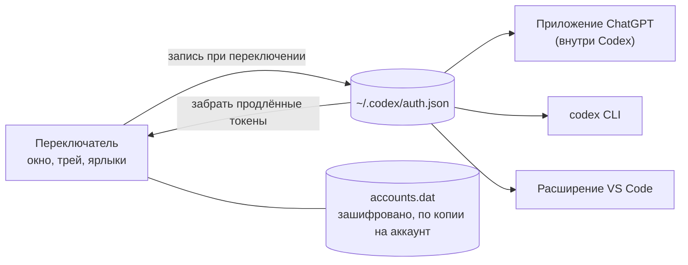

# Как это работает

Что переключатель делает, чтобы перевести Codex на другой аккаунт, чего не трогает и что куда отправляет. Как пользоваться — в [руководстве](guide.ru.md).

[English](how-it-works.md)

- [Идея](#идея)
- [Продлённые входы](#продлённые-входы)
- [По шагам](#по-шагам)
- [Вход](#вход)
- [Лимиты, статистика и прогрев](#лимиты-статистика-и-прогрев)
- [Продолжение остановленных разговоров](#продолжение-остановленных-разговоров)
- [Резервные копии](#резервные-копии)
- [Страница в браузере](#страница-в-браузере)
- [Безопасность и приватность](#безопасность-и-приватность)
- [Что общее у всех аккаунтов](#что-общее-у-всех-аккаунтов)

## Идея

Любой Codex — приложение, CLI и расширения редакторов — берёт вход из одного файла: `auth.json` в `%USERPROFILE%\.codex` (или в `CODEX_HOME`). В нём токены ChatGPT одного аккаунта. Переключатель хранит копию этого файла для каждого вашего аккаунта и, чтобы переключить, записывает выбранную копию обратно.

## Продлённые входы

ChatGPT продлевает вход, заменяя его refresh-токен, и старый перестаёт работать; повторное использование старого может завершить весь вход. Codex сам продлевает вход, которым пользуется, и перезаписывает `auth.json`. Значит, копия в `auth.json` — самая свежая для своего аккаунта, а сохранённая раньше может быть уже мёртвой.

Поэтому переключатель забирает эту копию в хранилище перед каждым переключением, при каждой проверке (раз в 2 секунды, пока открыто окно, раз в 20 из трея) и перед любым запросом к OpenAI. Копия забирается, только если она не старее сохранённой, так что Codex, всё ещё работающий со старым входом, не перезапишет более новый. И переключатель никогда не продлевает вход, которым пользуется Codex, пока запущен хоть какой-то Codex: тогда у Codex остался бы мёртвый токен.

## По шагам

1. **Находит приложение.** Пакет `OpenAI.Codex` из Store — через реестр пакетов пользователя. Теперь его приложение — ChatGPT (`app\ChatGPT.exe`) с Codex внутри; старая версия — `Codex.exe`. Другой exe можно указать через `--codex-path`.
2. **Хранит аккаунты.** `%LOCALAPPDATA%\CodexAccounts\accounts.dat` содержит `auth.json`, имя, email, тариф и идентификаторы каждого аккаунта в зашифрованном виде. Пароли, ключи 2FA и заказы из управления аккаунтами лежат в `logins.dat`, зашифрованные так же; настройки и последние полученные лимиты — рядом, в `settings.json` и `usage.json`.
3. **Знает, какой аккаунт используется,** по идентификаторам рабочего пространства и пользователя ChatGPT в токенах `auth.json`, поэтому один email в двух рабочих пространствах — это два аккаунта.
4. **Переключает.** Забирает продлённую копию; если токен нового аккаунта истёк, сначала продлевает его; закрывает дерево процессов приложения, если оно запущено, и завершает серверы приложений, которые запускают редакторы (они перезапускаются сами); записывает `auth.json` (во временный файл, затем подменяет, так что он никогда не бывает записан наполовину); открывает приложение с новым аккаунтом через его пакет, как меню «Пуск» (или только если оно было открыто, если так задано в настройках).
5. **Следит.** Снимок процессов показывает приложение, сеансы в терминалах и серверы редакторов, без WMI и PowerShell.

## Вход

**Добавить** делает то же, что `codex login`: разовый сервер на `localhost:1455` (или 1457 — это два порта, которые OpenAI принимает для Codex) и браузер, отправленный на `auth.openai.com` с PKCE. Принимается только ответ со случайным `state` именно этого входа; одноразовый код обменивается на токены по HTTPS, и сервер закрывается. Одно добавление: `prompt=login`, чтобы страница всегда спрашивала аккаунт, а не возвращала тот, в котором уже открыт браузер.

## Лимиты, статистика и прогрев

Каждый запрос ниже идёт в OpenAI с собственным access-токеном аккаунта и заголовками, которые шлёт Codex (`ChatGPT-Account-Id`, `originator: codex_cli_rs`).

- **Лимиты** берутся из `GET https://chatgpt.com/backend-api/wham/usage` — того же запроса, что делает `/status` в Codex. В ответе 5-часовое и недельное окна, сколько израсходовано в каждом, когда каждое сбросится и сколько у аккаунта сбросов лимита. Если они есть, `GET …/wham/rate-limit-reset-credits` говорит, когда сгорает первый.
- **Статистика** — `GET …/wham/profiles/me`, цифры, которые Codex ведёт по аккаунту: токены по дням, серии, самая долгая задача, разговоры, навыки и плагины. `GET …/accounts/check/v4-2023-04-27` добавляет тариф и дату продления или окончания подписки. Они запрашиваются, только когда открывается окно подробностей.
- **Прогрев** — один запрос к `https://chatgpt.com/backend-api/codex/responses` со словом «Hi» самой маленькой модели из списка Codex, с низким уровнем рассуждений и без сохранения. Первый запрос после окончания окна запускает следующее. Заданное время проверяется раз в полминуты; время, прошедшее больше двух минут назад, пока компьютер спал, пропускается.
- **Продление** входа — `POST https://auth.openai.com/oauth/token`, тот же запрос, что делает Codex, и только для аккаунтов, которые Codex не использует, или когда Codex не запущен.

## Продолжение остановленных разговоров

Codex пишет каждый разговор в журнал `.codex\sessions\ГГГГ\ММ\ДД\rollout-*.jsonl`. Переключатель читает журналы, изменённые за последние сутки, — первую строку и последние 2 МБ каждого (и никогда их не пишет), — и выбирает разговоры, чей последний ход закончился собственной ошибкой лимита Codex: событием ошибки с `usage_limit_exceeded` или неудачным ходом, сообщение которого начинается с «You've hit your usage limit». Те же слова, процитированные в сообщении или выводе инструмента, не считаются, разговор, в который вы с тех пор писали, пропускается, как и субагенты — ими управляет родительский разговор.

Для каждого, не больше 32, начиная с самых свежих:

1. *до* любой отправки в `%LOCALAPPDATA%\CodexAccounts\recovery\<разговор>.json` пишется квитанция, так что сбой или повторный запуск не отправят сообщение дважды;
2. `codex queue --thread <id> --message …` ставит в очередь «Continue the previous task.» с последней строкой `[Codex Account Switcher recovery: <случайный id>]`, по которой это сообщение можно узнать; CLI запускается без окна и останавливается через 10 секунд;
3. `codex://threads/<id>` открывает разговор в приложении ChatGPT, и оно отправляет то, что в очереди;
4. журнал проверяется на новый ход с этим самым сообщением до минуты (до двух минут на все).

Квитанция удаляется, когда ход появился. Разговор, сообщение которого осталось в очереди, попадает в отчёт, а не ставится в очередь снова, если только вы с тех пор в нём не писали; разговор, чей журнал больше не читается, сохраняет квитанцию. Если CLI точно не поставил сообщение в очередь (не запустился или завершился ошибкой), квитанция удаляется и ждать нечего. Переключение аккаунта или выход из переключателя останавливают обработку на следующем шаге.

## Резервные копии

**Сохранить…** записывает все аккаунты (их `auth.json`, имя и время последнего использования) в JSON и шифрует:

| Байты | |
| --- | --- |
| 4 | `CASB` |
| 1 | версия формата, 1 |
| 4 | итерации PBKDF2, little-endian: 600 000 |
| 16 | соль, случайная |
| 12 | nonce, случайный |
| остальное | шифротекст AES-256-GCM и его 16-байтовый тег |

Ключ — PBKDF2-HMAC-SHA256 от вашего пароля (UTF-8) и соли; и то и другое делает BCrypt Windows. **Скопировать текстом** — те же байты как `cas1.` и base64url. По файлу не видно, какие в нём аккаунты, а неверный пароль или изменённый байт не проходят проверку тега, а не дают мусор.

Читается и экспорт Codex Switcher: файлы `.cswf` (XChaCha20-Poly1305 с паролем, встроенным в Codex Switcher, затем zlib) и текст `css1.` (zlib JSON с именем и refresh-токеном каждого аккаунта; остальное переключатель получает, продлевая вход).

## Страница в браузере

По умолчанию выключена. Когда включена, небольшой HTTP-сервер слушает `127.0.0.1:3210`, а с **Пускать другие устройства** — все сетевые интерфейсы. Каждый запрос должен нести ключ из ссылки (`?key=…`, 24 случайных символа, сравнение за постоянное время), иначе получает 401. Страница и её данные:

- `GET /` — сама страница, с Content-Security-Policy, которая ничего не грузит извне, `X-Frame-Options: DENY` и без кеширования;
- `GET /api/state` — список: имена, email (скрытые, если email скрыты), тарифы, лимиты, какой аккаунт используется. Никогда не токены;
- `POST /api/switch`, `/api/refresh`, `/api/warmup`, `/api/open` делают то же, что кнопки в окне. Им нужен POST, так что ссылка или картинка на другом сайте их не вызовет, и ключ, которого другие сайты знать не могут.

Страница работает по обычному HTTP: в сети, которой вы не доверяете, тот, кто видит трафик, может забрать ссылку. **Новая ссылка** меняет ключ.

## Безопасность и приватность

- **Зашифровано на диске.** Хранилище зашифровано DPAPI Windows для вашего пользователя, с собственной энтропией переключателя. Другой пользователь Windows или файл, скопированный на другой компьютер, его не прочитают. Хранилище, которое не читается, откладывается в сторону, а не перезаписывается.
- **Токены уходят только в OpenAI** — по HTTPS, на адреса выше, перенаправления запрещены. В журнал ошибок они не попадают, и ни страница в браузере, ни `codex queue` их не получают.
- **Никакой телеметрии.** Единственный другой запрос — проверка обновлений: номер последнего релиза у `api.github.com` при запуске и раз в 6 часов («Настройки → О программе» могут это отключить). Обновление ставится только по кнопке **Обновить** и только если его SHA-256 совпадает с `SHA256SUMS.txt` релиза.
- **Codex не изменяется.** Пишется только `auth.json`; `config.toml`, история, сеансы и всё остальное в папке Codex не трогаются. Продолжение разговоров читает журналы сеансов и добавляет сообщение через собственный CLI Codex.
- **Без прав администратора.** Всё лежит в вашем профиле: `%LOCALAPPDATA%\CodexAccounts`, `auth.json`, ярлыки и значение `HKCU\…\Run` для запуска с Windows.
- **Ничего не слушает по умолчанию.** Сервер входа живёт, только пока ждёт вход; страница в браузере — только когда вы её включили.
- **Сохранить auth.json** и **Сохранить…** в резервной копии намеренно записывают входы в файл: первое в открытом виде после вопроса, второе под вашим паролем. Обращайтесь с обоими как с паролем.

Нашли уязвимость? См. [SECURITY.md](../SECURITY.md).

## Что общее у всех аккаунтов

Меняется только вход. Всё остальное в папке Codex — один набор на все аккаунты: `config.toml`, MCP-серверы, навыки, промпты, история и сеансы. Разговор, начатый в одном аккаунте, можно продолжить в другом.
